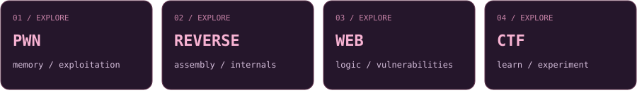

 
 

<samp>security research · pwn · reverse engineering · development</samp>

 
 

&nbsp;&nbsp;

&nbsp;&nbsp;

 
 

### About me

I'm a developer drawn to **cybersecurity, low-level systems, and offensive security**.

I like following a program beneath the surface: through its logic, into memory, and down to the assumptions that make it work — or break.

I explore **binary exploitation, reverse engineering, and web security**, solve CTF challenges, and build tools to make sense of what I find.

 

 
### Beneath the surface

I'm curious about the gap between what software is supposed to do
and what it can be made to do.

Sometimes that means tracing a binary, chasing a bug through memory,
or finding an unexpected path through an application.
CTFs give me a place to experiment; development gives me a way
to turn what I learn into tools.

 

 

<samp>follow the logic. question the assumptions.</samp>

 
 

Shades of pink. Curiosity for the details.

